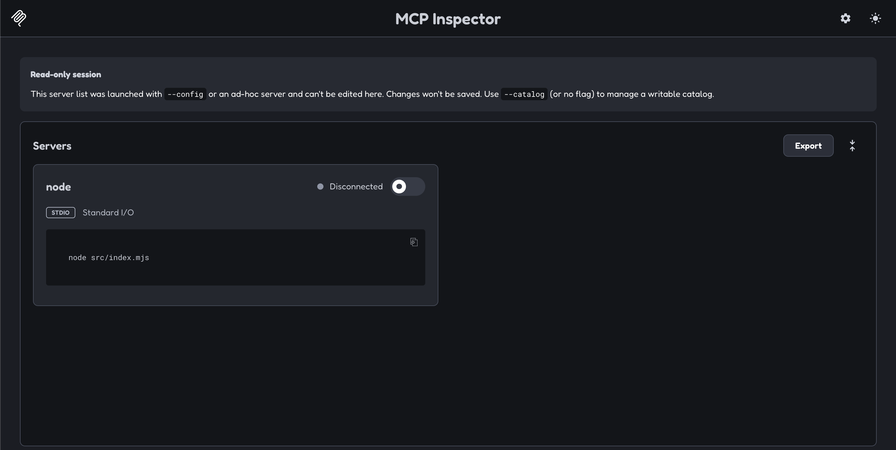
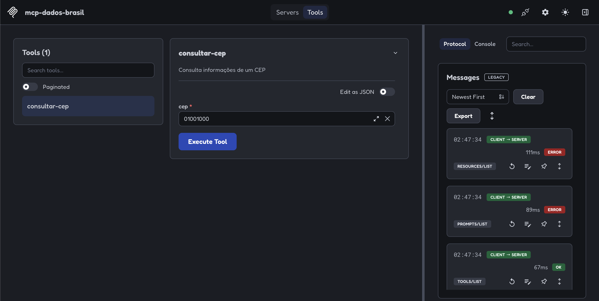
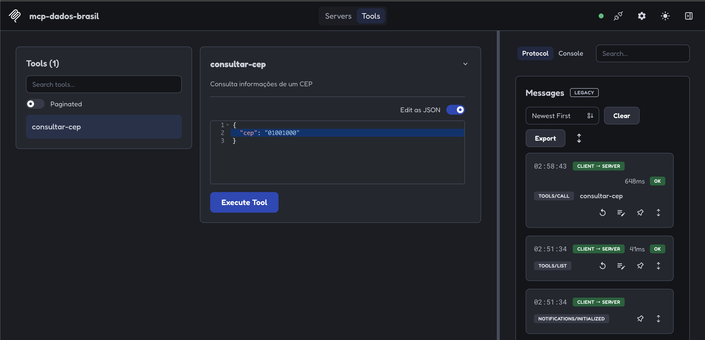
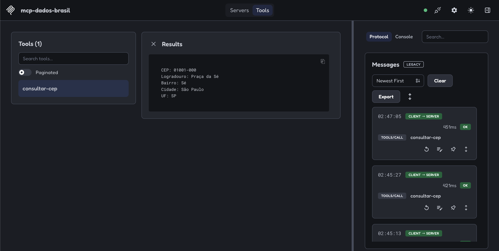
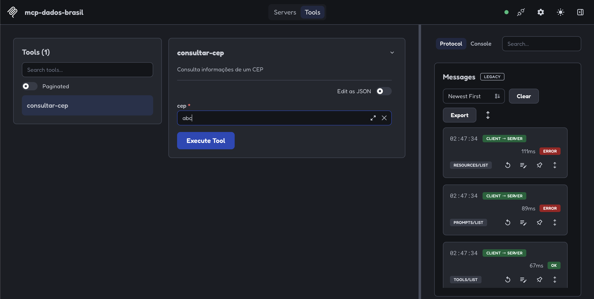
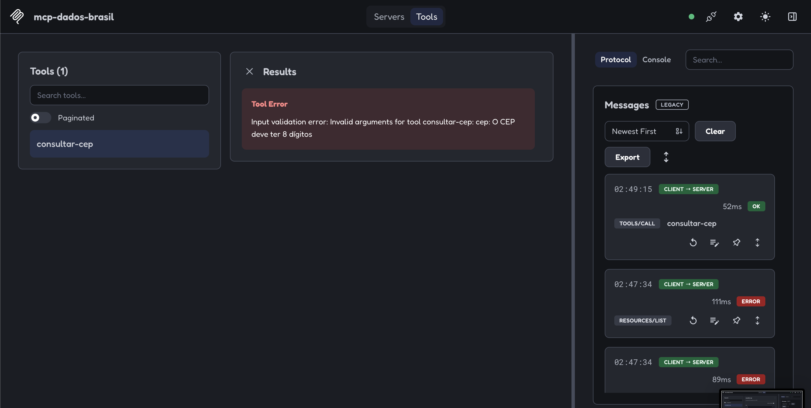

# mcp-dados-brasil

Servidor MCP em JavaScript e Node.js para consultar dados públicos do Brasil. A primeira ferramenta disponível consulta endereços brasileiros a partir de um CEP usando o [ViaCEP](https://viacep.com.br/).

## Sumário

- [Objetivo](#objetivo)
- [Entendendo o MCP neste projeto](docs/entendendo-mcp.md)
- [O que a ferramenta faz](#o-que-a-ferramenta-faz)
- [Requisitos](#requisitos)
- [Instalação](#instalação)
- [Como o servidor inicia](#como-o-servidor-inicia)
- [Como testar com o MCP Inspector](#como-testar-com-o-mcp-inspector)
  - [Conectar ao servidor](#passo-1-conectar-ao-servidor)
  - [Abrir a ferramenta](#passo-2-abrir-a-ferramenta)
  - [Consultar um CEP válido](#passo-3-consultar-um-cep-válido)
  - [Conferir a validação](#passo-4-conferir-a-validação)
- [Testes automatizados](#testes-automatizados)
- [Estrutura do projeto](#estrutura)

## Objetivo

Este projeto mostra como disponibilizar uma API pública como ferramenta MCP. Um cliente MCP pode descobrir a ferramenta `consultar-cep`, enviar um CEP e receber o endereço correspondente. No momento, o servidor oferece apenas a consulta de CEP.

Se você está usando este repositório para estudar, leia também o guia [Entendendo o MCP neste projeto](docs/entendendo-mcp.md), que explica os conceitos e reúne a documentação oficial usada na implementação.

## O que a ferramenta faz

`consultar-cep` recebe o argumento `cep` como uma string de **8 dígitos, sem hífen**. Ela valida a entrada, consulta o ViaCEP e retorna CEP, logradouro, bairro, cidade e UF.

Exemplo de entrada:

```json
{ "cep": "01001000" }
```

Exemplo de resultado:

```text
CEP: 01001-000
Logradouro: Praça da Sé
Bairro: Sé
Cidade: São Paulo
UF: SP
```

Um CEP com formato inválido é rejeitado pela validação. Se o CEP não existir, a ferramenta informa que ele não foi encontrado. Falhas na consulta ao ViaCEP também são retornadas como erro da ferramenta.

## Requisitos

- Node.js 20 ou superior para o servidor. Para seguir o teste com a versão atual do MCP Inspector, use Node.js 22.19 ou superior, com npm.
- Conexão com a internet para consultar o ViaCEP.

## Instalação

Clone o repositório e instale as dependências:

```bash
git clone https://github.com/PaulinhaFigueiredoDev/mcp-dados-brasil.git
cd mcp-dados-brasil
npm ci
```

O projeto usa `@modelcontextprotocol/server` para criar o servidor MCP e `zod` para validar os argumentos da ferramenta. As dependências estão declaradas no `package.json`; não é necessário instalá-las globalmente.

## Como o servidor inicia

O arquivo `src/index.mjs` cria uma instância de `McpServer`, registra a ferramenta `consultar-cep` e a entrega a `serveStdio`. O servidor se comunica com o cliente MCP pela entrada e saída padrão do processo (`stdin` e `stdout`). Ele não abre uma porta HTTP.

Para iniciar o processo diretamente, execute na raiz do repositório:

```bash
node src/index.mjs
```

O terminal ficará aguardando a conexão de um cliente MCP; não aparecerá uma página ou resposta nesse comando. Use `Ctrl+C` para encerrar. Quando um cliente MCP executa o servidor, ele inicia esse processo automaticamente.

## Como testar com o MCP Inspector

O [MCP Inspector](https://modelcontextprotocol.io/docs/tools/inspector) permite conectar ao servidor, chamar a ferramenta e ver as respostas. Na raiz do repositório, execute:

```bash
npx @modelcontextprotocol/inspector node src/index.mjs
```

O Inspector inicia o servidor e abre uma página no navegador. **Não execute `node src/index.mjs` separadamente** durante esse teste: o Inspector inicia o processo para você.

### Passo 1: conectar ao servidor

Na tela inicial, localize o servidor `node`. Ele aparece como **Disconnected** e mostra o comando `node src/index.mjs` e o transporte **STDIO**.



Clique no botão de conexão à direita do nome do servidor. O estado deve mudar para **Connected**, como na imagem abaixo. A indicação **Read-only session** significa apenas que a configuração desse servidor foi passada ao iniciar o Inspector e não será editada pela interface.


### Passo 2: abrir a ferramenta

Clique na aba **Tools**, na parte superior da página. A lista à esquerda deve mostrar uma ferramenta: `consultar-cep`.


Clique em **consultar-cep** para abrir o formulário. O campo `cep` tem um asterisco porque é obrigatório. Você pode usar o campo normal ou ativar **Edit as JSON**; os dois modos enviam o mesmo argumento à ferramenta.


### Passo 3: consultar um CEP válido

Você pode preencher a entrada de duas formas. Escolha **uma** delas e clique em **Execute Tool**.

**Entrada simples:** deixe **Edit as JSON** desligado e digite apenas `01001000` no campo `cep`, sem hífen. Não é preciso escrever o nome do campo nem as chaves do JSON.



**Entrada JSON:** ative **Edit as JSON** e informe o objeto completo, incluindo o nome do argumento:

```json
{ "cep": "01001000" }
```



Nesse modo, digitar somente `01001000` não funciona, porque a ferramenta espera um objeto com a propriedade `cep`. Os dois modos enviam o mesmo argumento à ferramenta.

Na área **Results**, o endereço deve aparecer com CEP, logradouro, bairro, cidade e UF. O ViaCEP pode devolver o CEP formatado com hífen, como `01001-000`.



### Passo 4: conferir a validação

Selecione a ferramenta novamente, substitua o CEP por `abc` e clique em **Execute Tool**. Esse valor não tem 8 dígitos numéricos.



O resultado esperado é **Tool Error**, com a mensagem **O CEP deve ter 8 dígitos**. A validação ocorre antes da consulta ao ViaCEP.



Você também pode testar `00000000`. Ele passa pela validação de formato, mas o ViaCEP não encontra um endereço; a ferramenta deve responder `CEP 00000000 não encontrado.`. Isso demonstra a diferença entre **entrada inválida** e **CEP inexistente**.

O painel **Protocol**, à direita, registra as mensagens trocadas entre o Inspector e o servidor. As capturas mostram algumas consultas a `resources/list` e `prompts/list` com erro; este projeto oferece apenas uma tool, então essas mensagens não impedem a consulta de CEP.

## Testes automatizados

Execute os testes na raiz do repositório:

```bash
npm test
```

Os testes usam o executor do Node.js e simulam a resposta do ViaCEP. Assim, verificam CEP válido, formato inválido, CEP inexistente e falhas da API sem depender da internet. O workflow em `.github/workflows/ci.yml` executa os testes em cada pull request e em atualizações da `main`.

## Estrutura

```text
mcp-dados-brasil/
├── src/
│   ├── index.mjs      # Inicia o servidor MCP e registra a ferramenta
│   └── consultar-cep.mjs # Validação e consulta ao ViaCEP
├── test/              # Testes automatizados da consulta
├── .github/workflows/ # Testes automáticos no GitHub Actions
├── img/               # Capturas do fluxo de teste no Inspector
├── docs/
│   └── entendendo-mcp.md # Conceitos e referências para estudo
├── package.json       # Dependências do projeto
└── README.md
```
