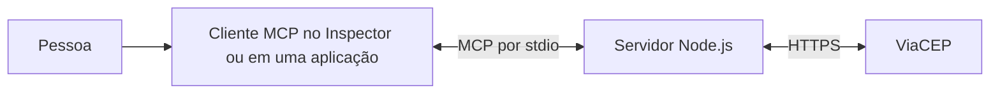

# Entendendo o MCP neste projeto

Este guia explica os conceitos usados no `mcp-dados-brasil`. Para instalar e executar o servidor, consulte o [README](../README.md).

## O que é MCP?

**MCP (Model Context Protocol)** é um protocolo que define como aplicações podem descobrir e usar dados e funcionalidades oferecidos por servidores externos. Ele estabelece as mensagens trocadas entre um **cliente MCP** e um **servidor MCP**. Uma aplicação de IA pode usar esse cliente para oferecer ferramentas a um modelo, mas o servidor MCP não precisa conter um modelo de IA. [Leia a visão geral da arquitetura oficial](https://modelcontextprotocol.io/docs/learn/architecture).

Neste repositório, o servidor é um programa Node.js que oferece as ferramentas `consultar-cep` e `buscar-ceps-por-endereco`. O [ViaCEP](https://viacep.com.br/) é a API HTTP consultada pelas ferramentas. **MCP é a comunicação com o cliente; ViaCEP é a fonte dos dados dos endereços.**

## Quem participa da comunicação?

| Participante | Papel neste projeto |
| --- | --- |
| Pessoa | Informa um CEP ou os dados de um endereço e solicita a consulta. |
| Aplicação com cliente MCP | Descobre a ferramenta e envia a chamada. Nos testes deste repositório, esse papel é exercido pelo MCP Inspector. |
| Servidor MCP | Recebe a chamada de uma das ferramentas, valida os argumentos e devolve o resultado. Os registros estão em `src/index.mjs`; as consultas ficam em módulos próprios na pasta `src/`. |
| ViaCEP | Recebe a requisição HTTPS do servidor e devolve os dados do endereço. |

Uma aplicação de IA costuma atuar como **host** e manter um cliente MCP para cada servidor ao qual se conecta. O Inspector é uma ferramenta de teste que faz o papel de cliente sem precisar de um modelo de IA. [Arquitetura oficial](https://modelcontextprotocol.io/docs/learn/architecture).

## O que um servidor MCP pode oferecer?

- **Tools:** funções que o cliente pode descobrir e chamar, como `consultar-cep` e `buscar-ceps-por-endereco`.
- **Resources:** dados que o cliente pode ler por uma URI.
- **Prompts:** modelos de mensagens reutilizáveis.

Este projeto implementa **duas tools**. Por isso, a aba **Tools** do Inspector mostra `consultar-cep` e `buscar-ceps-por-endereco`; não há resources nem prompts cadastrados. A [especificação de tools](https://modelcontextprotocol.io/specification/2026-07-28/server/tools) descreve os campos de uma ferramenta e as operações `tools/list` e `tools/call`.

## Como a consulta de CEP acontece?

1. O cliente MCP descobre a ferramenta `consultar-cep` e seu argumento obrigatório `cep`.
2. A pessoa informa `01001000`. No formulário do Inspector, basta preencher o campo; no modo JSON, a entrada é `{ "cep": "01001000" }`.
3. O cliente envia a chamada da ferramenta ao servidor MCP. O SDK valida o CEP com o esquema Zod antes de executar a função.
4. O servidor chama `https://viacep.com.br/ws/01001000/json/` com o `fetch` do Node.js.
5. O servidor transforma a resposta em texto com CEP, logradouro, bairro, cidade e UF e a devolve ao cliente.

Se o CEP não tiver exatamente oito dígitos, a validação interrompe a chamada antes do `fetch`. Se o ViaCEP indicar um CEP inexistente ou a consulta falhar, a ferramenta devolve um resultado de erro. Veja o [passo a passo com capturas no README](../README.md#como-testar-com-o-mcp-inspector).

## Como a busca por endereço acontece?

1. O cliente descobre `buscar-ceps-por-endereco` e seus três argumentos obrigatórios: `uf`, `cidade` e `logradouro`.
2. A pessoa informa, por exemplo, `{ "uf": "SP", "cidade": "São Paulo", "logradouro": "Praça da Sé" }`.
3. O esquema Zod valida que a UF tem duas letras e que cidade e logradouro têm pelo menos três caracteres. O servidor remove espaços nas extremidades e envia a UF em maiúsculas.
4. O servidor consulta o endpoint de [pesquisa de CEP do ViaCEP](https://viacep.com.br/) com os segmentos da URL codificados. Diferentemente da consulta por CEP, a resposta é uma lista de endereços.
5. A tool mostra até 10 endereços com CEP, logradouro, bairro, cidade e UF. Se não houver correspondências, informa isso ao cliente; se a API falhar, devolve um resultado de erro.

O ViaCEP informa um máximo de 50 CEPs por pesquisa. Para encontrar um CEP específico, informe um logradouro mais completo. Consulte o [exemplo de uso no README](../README.md#buscar-ceps-pelo-endereço).

## Onde cada conceito aparece no código?

| Código | Função |
| --- | --- |
| `new McpServer(...)` em `src/index.mjs` | Cria o servidor e define seu nome e versão. |
| `serveStdio(...)` em `src/index.mjs` | Conecta o servidor à entrada e saída padrão do processo. |
| `server.registerTool(...)` em `src/index.mjs` | Publica o nome, a descrição, a entrada e a função de cada tool. |
| `z.object(...)` e `z.string().regex(...)` em `src/consultar-cep.mjs` | Descrevem e validam o argumento `cep`. |
| `fetch(...)` em `src/consultar-cep.mjs` | Consulta a API do ViaCEP por HTTPS. |
| `content` e `isError` em `src/consultar-cep.mjs` | Devolvem ao cliente o endereço ou uma mensagem de erro. |
| `enderecoInputSchema` em `src/buscar-ceps-por-endereco.mjs` | Valida UF, cidade e logradouro para a pesquisa. |
| `buscarCepsPorEndereco(...)` em `src/buscar-ceps-por-endereco.mjs` | Consulta o ViaCEP e apresenta uma lista de até 10 endereços. |

O transporte **stdio** usa a entrada (`stdin`) e a saída (`stdout`) do processo para trocar mensagens do protocolo. Por isso, quando um cliente inicia o servidor, `stdout` deve ficar livre para essas mensagens; logs de depuração devem ir para `stderr`, por exemplo com `console.error`. O servidor deste repositório não abre uma porta HTTP. [Documentação oficial de stdio no SDK](https://ts.sdk.modelcontextprotocol.io/v2/serving/stdio).

## Documentação usada e leituras recomendadas

### MCP e ferramentas

- [Visão geral da arquitetura MCP](https://modelcontextprotocol.io/docs/learn/architecture): host, cliente, servidor, transportes e tipos de conteúdo.
- [Especificação oficial de tools](https://modelcontextprotocol.io/specification/2026-07-28/server/tools): descoberta, chamada, esquema de entrada e formato da resposta.
- [Primeiro servidor com o SDK de TypeScript](https://ts.sdk.modelcontextprotocol.io/v2/get-started/first-server): criação do `McpServer`, registro de tool e teste. Os exemplos estão em `.ts`; este projeto aplica as mesmas APIs em JavaScript `.mjs`, sem anotações de tipo.
- [Tools no SDK](https://ts.sdk.modelcontextprotocol.io/v2/servers/tools): detalhes de `registerTool`, `inputSchema` e resultados.
- [Servidor por stdio](https://ts.sdk.modelcontextprotocol.io/v2/serving/stdio): funcionamento de `serveStdio` e uso correto de `stdout` e `stderr`.
- [MCP Inspector](https://modelcontextprotocol.io/docs/tools/inspector): ferramenta oficial usada para testar este servidor no navegador.

### API e bibliotecas deste projeto

- [ViaCEP](https://viacep.com.br/): formatos de URL para consulta por CEP e pesquisa por endereço, campos devolvidos e limites da pesquisa.
- [Zod — conceitos básicos](https://zod.dev/basics): criação de esquemas e validação de entradas.
- [Node.js — `fetch` e `AbortSignal.timeout`](https://nodejs.org/api/globals.html): chamada HTTP e limite de tempo usados na consulta.
- [Node.js — módulos ECMAScript](https://nodejs.org/api/esm.html): por que o arquivo `.mjs` pode usar `import` em JavaScript.

Para estudar em ordem, comece pela **arquitetura MCP**, siga para **primeiro servidor**, depois leia **tools** e **stdio**. Use a documentação do ViaCEP, Zod e Node.js para entender a implementação específica deste repositório.
